# 健身达人 · 微信小程序（前端）

> 给刚开始、或断断续续去健身房的人：**记一次训练只要几下点按，练完直接得到一张能发朋友圈的打卡海报。**
> 界面以图标为主、文字尽量少；训练数据默认只存在自己的手机里，不用注册。

<p align="center">
  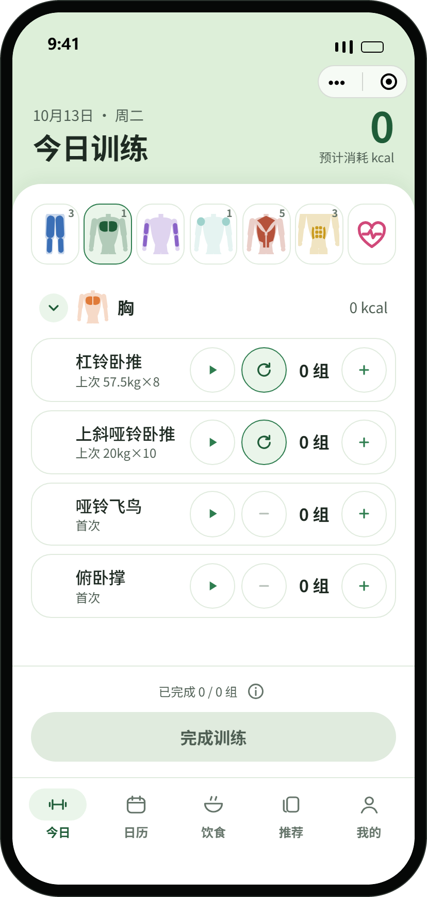
  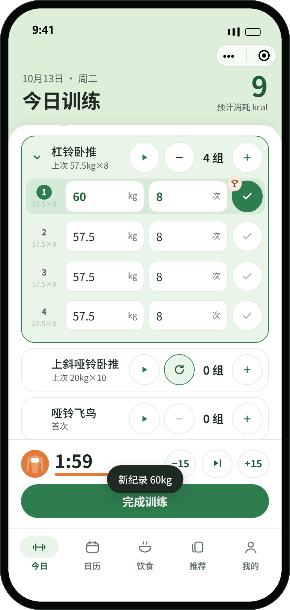
  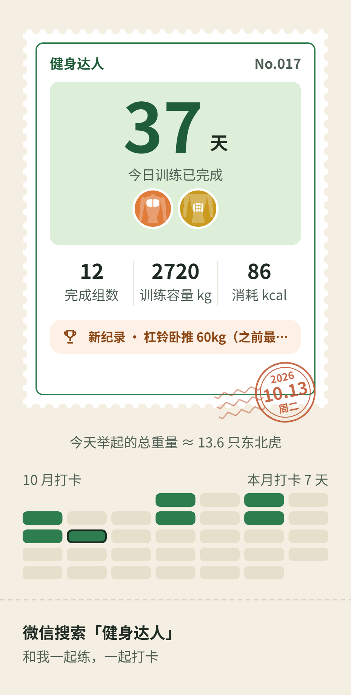
</p>

## 界面一览

下面所有图都是用本仓库的真实代码在浏览器预览里渲染、截下来的（演示数据，人物与成绩都是虚构的），不是设计稿。

<table>
  <tr>
    <td align="center"><br><b>今日 · 选部位</b><br><sub>图块是肌肉图，右上角是休息了几天；↻ 一键照上次</sub></td>
    <td align="center"><br><b>今日 · 训练中</b><br><sub>打勾即开始休息计时，破纪录当场出奖杯</sub></td>
    <td align="center">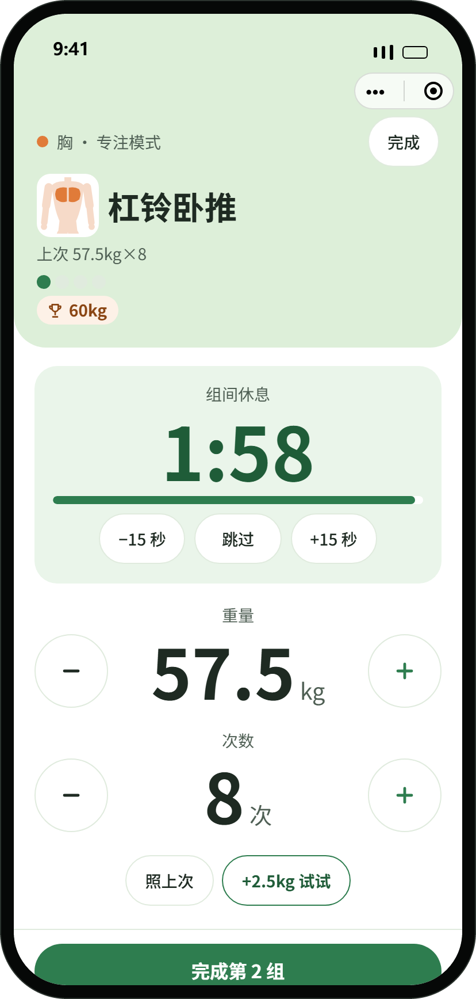<br><b>专注模式</b><br><sub>大号步进、组间休息、动作小人形</sub></td>
  </tr>
  <tr>
    <td align="center">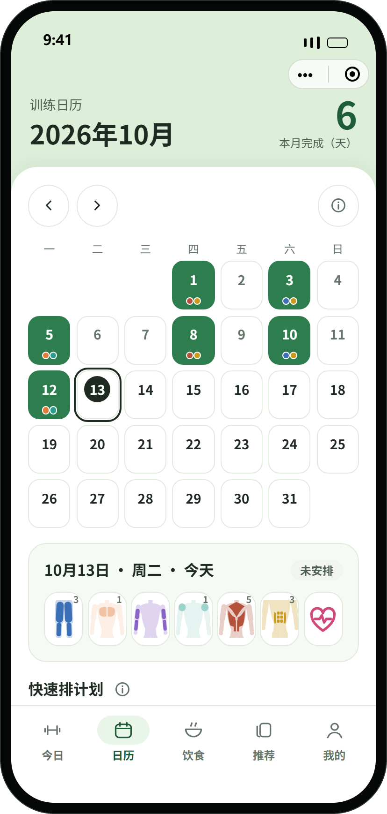<br><b>日历</b><br><sub>月视图、计划模板</sub></td>
    <td align="center">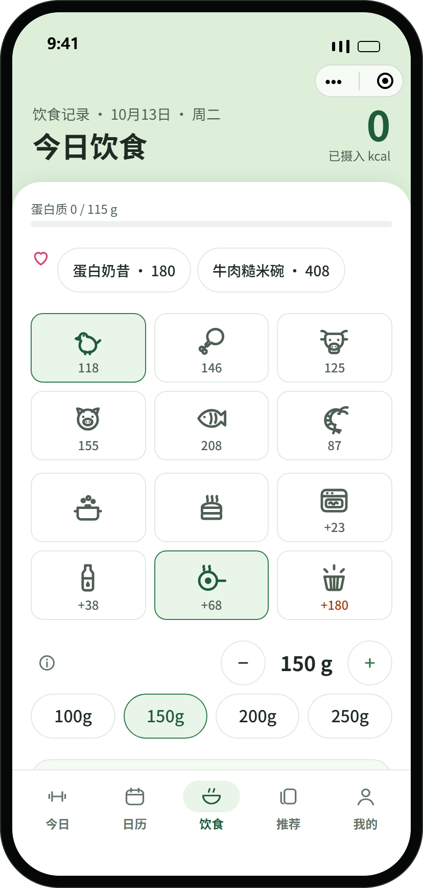<br><b>饮食</b><br><sub>肉类 × 做法 × 分量，全是图标；常吃置顶</sub></td>
    <td align="center">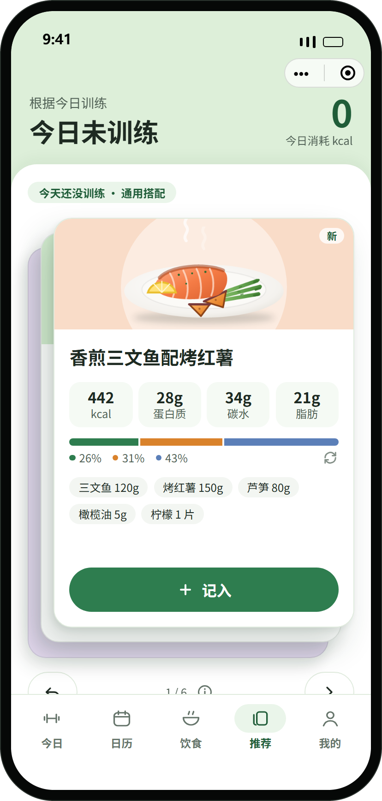<br><b>推荐练后餐</b><br><sub>卡片堆叠，左右滑；点开翻面看做法</sub></td>
  </tr>
  <tr>
    <td align="center">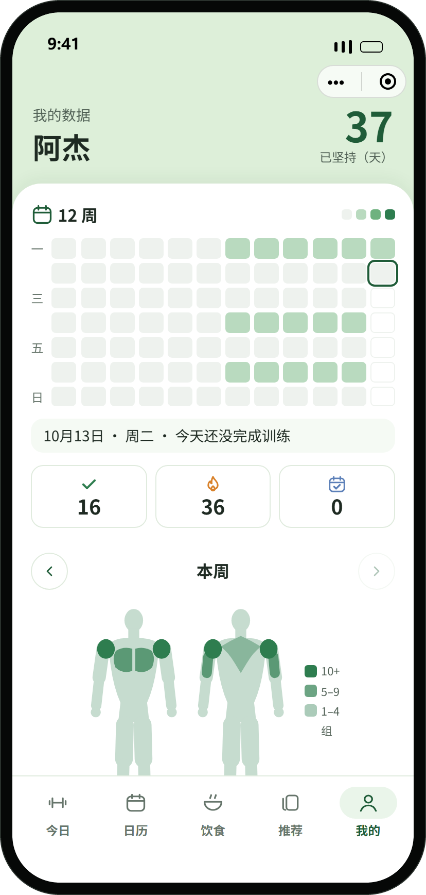<br><b>我的 · 12 周热力图</b><br><sub>已坚持 N 天、连续达标周数</sub></td>
    <td align="center">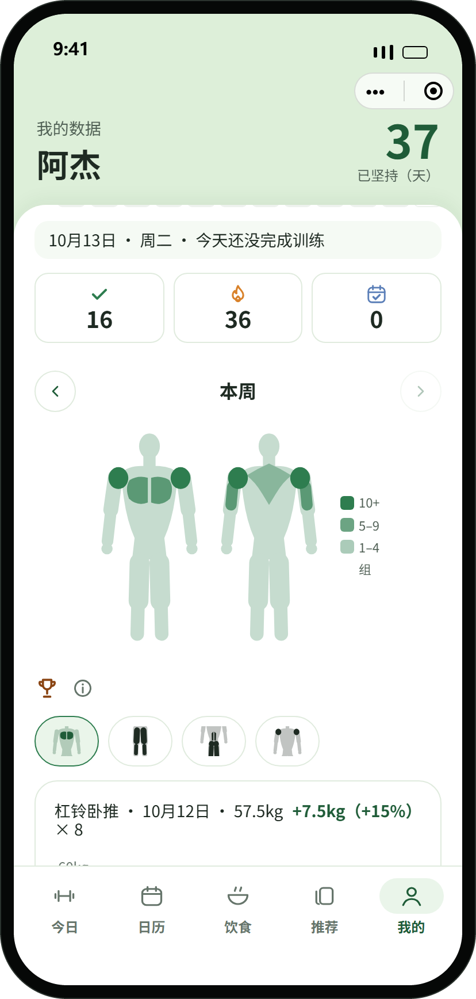<br><b>我的 · 本周肌群</b><br><sub>正背面人体图，按完成组数分三档深浅</sub></td>
    <td align="center">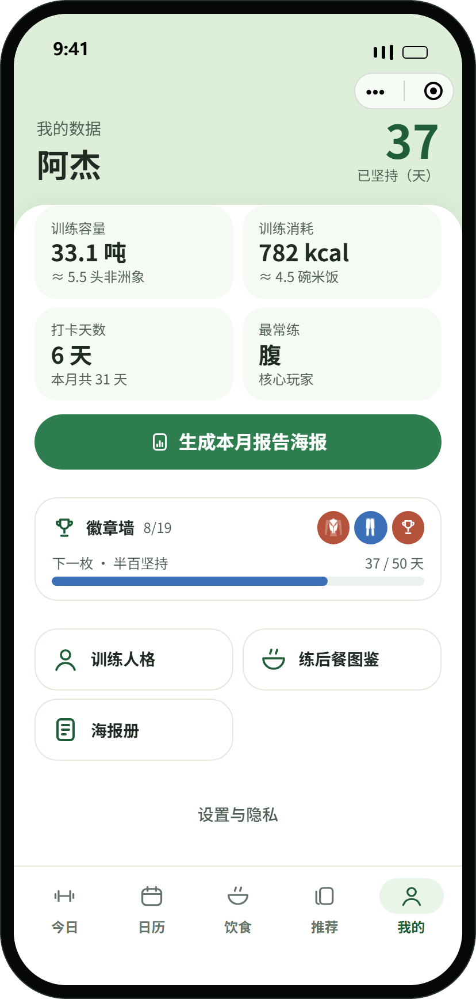<br><b>我的 · 月成绩与徽章</b><br><sub>最近的徽章和下一枚的进度</sub></td>
  </tr>
  <tr>
    <td align="center"><br><b>邮票版打卡海报</b><br><sub>齿孔邮票 + 日期邮戳，导出 PNG 发朋友圈</sub></td>
    <td align="center">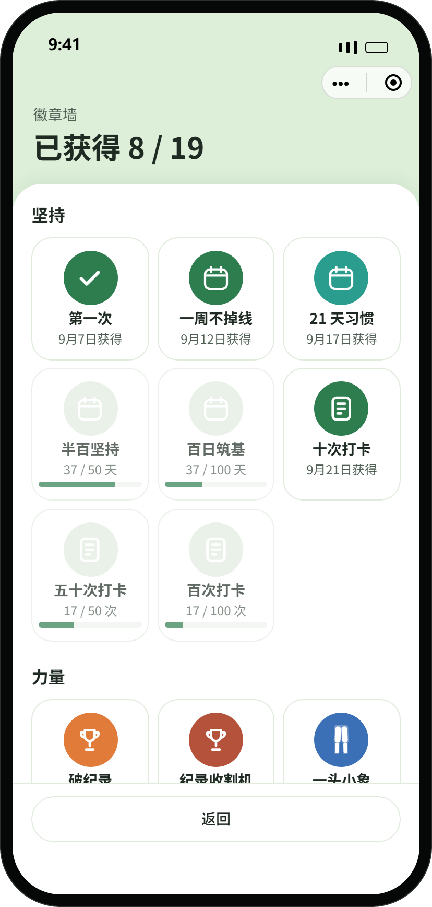<br><b>徽章墙</b><br><sub>19 枚，带进度条</sub></td>
    <td align="center">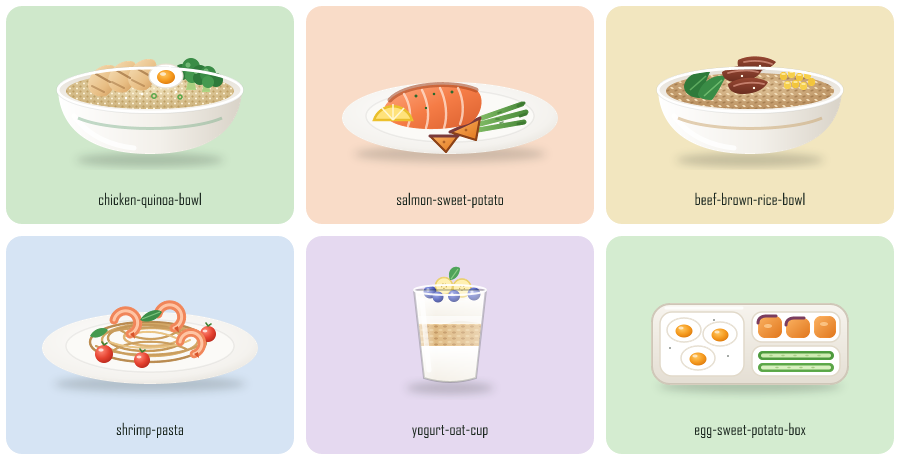<br><b>练后餐插画</b><br><sub>分层 SVG 拼装，不靠拍照</sub></td>
  </tr>
</table>

## 它和别的训练记录有什么不一样

- **图标优先。** 部位、做法、肉类、主食、蔬果都用图标表示，页面上几乎没有说明文字。部位图标是**肌肉解剖图**：一个淡淡的人形，只高亮这个部位练到的肌肉，用户一眼就知道「练的是哪里」。
- **训练中少点几下。** 动作卡上的 ↻ 按上次那天的组数和每组重量一次排好，之后只要逐行打勾；打勾后底栏自动变成组间休息条；刷新纪录的那一组当场出现奖杯。
- **「已坚持」对一周练三次的人友好。** 相邻两次训练之间可以休 2 天，不会因为一天没去就清零；页头用两个小月亮告诉你「还能休几天」。
- **每次打卡都是一张可以收藏的邮票。** 天数是面值，盖上当天的邮戳；徽章、月报、练后餐卡片也都能导出成图。
- **本地优先。** 训练数据按月分片存在手机本地，没有注册、没有账号；没有云开发时应用以纯本地模式完整可用。

## 怎么用

### 一次训练怎么走

1. 打开「今日」，点一个部位图块（也可以点上面那条推荐，它会推荐休息最久的部位）。图块右上角的数字是这个部位休息了几天，刚练过的会变淡。
2. 在动作卡上点 **↻** 一键照上次排好整套组，只改要改的重量；或者点 **+** 自己加一组。
3. 每做完一组，点右边的 **✓**。底栏会自动变成休息计时，可以 −15 / 跳过 / +15。
4. 想专心练一个动作，点动作卡上的 **▶** 进入专注模式。
5. 全部练完点「完成训练」：看到坚持天数和徽章，可以生成打卡海报，也可以看看练后吃什么。

### 饮食

在「饮食」页点一个肉类图标、一个做法图标，再调克数，点「记入」；主食和蔬果按 ½ / 1 / 2 份点选；常吃的东西在最上面，点一下就记入，记错了在提示条上点「撤回」。「推荐」页是按今天练的部位和你的体重排序的练后餐卡片。

## 本地运行

需要 [Node.js](https://nodejs.org/) 20 或更高版本。

```bash
git clone https://github.com/Yuhao1015/fitness-daren.git
cd fitness-daren
npm install
```

### 方式一：浏览器预览（推荐，什么都不用装）

```bash
npm run preview
```

打开 <http://localhost:5174/>。预览用 `tools/preview/` 里一个很小的运行时，直接读取小程序**真实的** wxml / wxss / ts / wxs 在浏览器里执行，用来验收布局和交互；它不是微信，真机表现以微信开发者工具为准。

左边是 390×844 的手机框，右边的面板可以载入演示数据（5 周训练记录）、切回「全新用户」走一遍引导、在各个页面之间跳转、切换屏幕宽度。

### 方式二：手机上直接看（同一 Wi-Fi）

`npm run preview` 起来后，终端会多打印一行「手机（同一 Wi-Fi）打开: http://192.168.x.x:5174/」。手机连同一个 Wi-Fi，用浏览器打开这个地址，会自动进入**直连模式**（去掉手机外框，小程序占满屏幕）。地址后面加参数载入数据：

| 参数 | 效果 |
|---|---|
| `?seed=demo` | 演示数据（5 周记录） |
| `?seed=done` | 演示数据 + 今天已打卡 |
| `?seed=fresh` | 全新用户，走一遍引导 |
| `?device=1` / `?device=0` | 强制直连 / 桌面模式 |

预览服务没有任何认证，只在自己的家庭或办公网络里用。

### 方式三：微信开发者工具（真实环境、真机预览）

1. 安装[微信开发者工具](https://developers.weixin.qq.com/miniprogram/dev/devtools/download.html)，用微信扫码登录。
2. 导入本项目目录。`project.config.json` 里的 `appid` 是游客模式的 `touristappid`，**游客模式不能真机预览**：导入时选「测试号」，或换成你自己的小程序 AppID。
3. 「详情 → 本地设置」确认勾选「使用 TypeScript 编译插件」（配置文件里已开启）。
4. 点「编译」；要在手机上看，点「预览」，用登录开发者工具的同一个微信扫码。

## 常用命令

| 命令 | 作用 |
|---|---|
| `npm test` | 单元测试（vitest）：核心逻辑与视图模型 |
| `npm run typecheck` | TypeScript 类型检查 |
| `npm run check:bindings` | wxml 里绑定的事件函数必须在页面 / 组件 ts 里存在 |
| `npm run check:project` | 页面、组件、`.wxs`、静态图片文件齐全（开发者工具编译才会暴露的缺失） |
| `npm run preview` | 浏览器预览 |
| `npm run shots` | 用本机 Chrome / Edge 驱动预览，重新截本页的界面图 |
| `npm run icons` | 重新导出海报用的图标 PNG |

## 目录结构

```
miniprogram/
  core/         纯 TypeScript 的业务逻辑（不碰 wx.*，都有单测）：连胜规则、纪录、肌群映射、海报排版、徽章……
  viewmodels/   页面数据由这里的纯函数生成；页面只做「读存储 → 建视图模型 → setData」
  services/     存储、同步、画布导出、分享等与 wx.* 打交道的薄封装
  pages/        五个页签：今日 / 日历 / 饮食 / 推荐 / 我的
  pkg-*/        分包：专注模式、新手引导、分享（海报、徽章、人格）、社交设置
  components/   图标、图标胶囊、页头、提示条、庆祝弹层……
tools/preview/  浏览器预览运行时（读真实的 wxml / wxss / ts 在浏览器里跑）
scripts/        文件齐全检查、绑定检查、图标 / 插画导出、截图
tests/          单元测试
art/、reference/  练后餐插画的 SVG 图层，以及最初的界面原型源文件
docs/specs/     界面设计笔记
```

## 开源范围

本仓库**只包含小程序前端**（`miniprogram/`、浏览器预览工具、前端单测和设计笔记）。云开发后端（云函数与数据库规则）不在其中，所以：

- 依赖后端的功能——分享归因与落地页转化、小程序码、搭子、打卡挑战、回响、订阅消息提醒——这里只有客户端代码，没有后端就联不通；不配置云开发环境时，这些入口自动不显示或降级成本地行为（比如海报底部写「微信搜索」而不是小程序码）。
- 训练记录、饮食、日历、推荐、徽章、训练人格、海报导出等**全部本地功能完整可用**。

## 设计笔记

`docs/specs/` 里是几次界面改动的设计笔记（为什么这样改、取舍和没验证的地方）：

- [图标优先的界面](docs/specs/2026-10-11-icon-first-ui.md)
- [部位图标改成肌肉解剖图](docs/specs/2026-10-11-muscle-icons.md)
- [邮票版打卡海报](docs/specs/2026-10-11-stamp-poster.md)
- [训练中体验改进](docs/specs/2026-10-11-training-loop-p0.md)
- [恢复状态、本周肌群与新手提示](docs/specs/2026-10-11-competitive-p1.md)

## 已知限制

- 在浏览器预览里逐页走查过；真机与开发者工具里没有逐项验证过的有：自定义 tabBar 的底部留白、SVG 透明度分档在真机上的渲染、画布导出海报的清晰度、`wx.loadFontFace` 字体加载。
- 肌肉图是示意用的简化人形，主要肌群与协同肌群的对应是常见的简化分法，不是运动解剖学教材。
- 训练人格、趣味换算（「举起 N 只东北虎」）是娱乐向的文案，不是测评。

## 许可证

暂未指定许可证（默认保留所有权利）。需要使用或转载请先联系作者。
